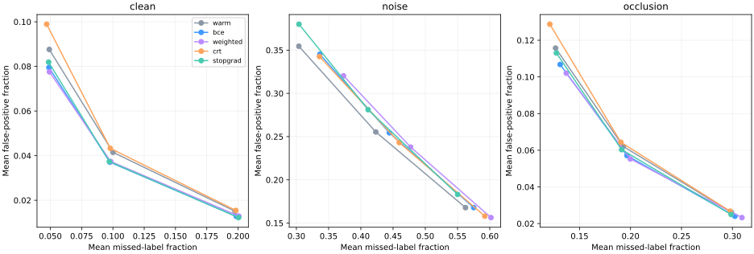
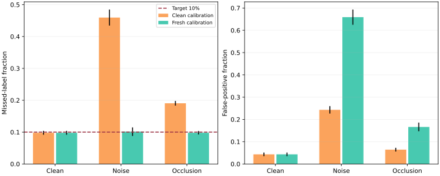
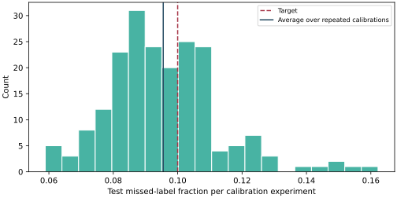

# Risk-aware recognition

An image can contain several digits. Returning fewer answers looks tidy, but it can hide a real digit; returning everything avoids misses and is useless. This project explores the trade-off with a small neural classifier, finite-sample calibration, and training that differentiates through the calibration threshold.

**[Open the experiment explorer](https://y4rik2009-bit.github.io/risk-aware-recognition/)** · [Method in Russian](METHOD_RU.md) · [Measured records](results/verified/metrics.csv)

The starting point is Yeh et al., [Conformal Risk Training, NeurIPS 2025](https://proceedings.neurips.cc/paper_files/paper/2025/hash/6559542f75b4452ebaaf82094c7defb7-Abstract-Conference.html). This repo tests the multi-label FNR setting on a smaller constructed task. It implements the active-score gradient, plus post-hoc mean-risk and CVaR calibration. It does not reproduce the paper's medical segmentation or battery experiments, and does not implement end-to-end CVaR training.

## What happened

The interesting result was the calibration/shift trade-off, rather than a win for the most complex training rule. At a 10% mean-risk budget on clean boards, continued cross-entropy had fewer false positives than risk training. Both used the same warm start and the same additional training budget.

| Training rule + clean CRC | Missed-label fraction | False-positive fraction | Mean set size |
| --- | ---: | ---: | ---: |
| Warm start | 0.1001 | 0.0415 | 2.0871 |
| Continued BCE | 0.0977 | **0.0371** | 2.0571 |
| Positive-weighted BCE | 0.0982 | 0.0374 | 2.0591 |
| Conformal risk training | 0.0979 | 0.0433 | 2.0963 |
| Risk objective, threshold gradient stopped | 0.0971 | 0.0373 | 2.0580 |

Means over ten seeds. These are per-image fractions averaged over images, not pooled counts over all labels. There are 1–3 true labels and ten possible labels per board. Small differences are exploratory; these are repeated splits of one source dataset, not ten independent datasets.



Changing the images makes the old risk budget unreliable. For the risk-trained model at the same 10% mean-risk budget:

| Test condition | Calibration | Missed-label fraction | False positives | Mean set size |
| --- | --- | ---: | ---: | ---: |
| Clean | Clean | 0.0979 | 0.0433 | 2.10 |
| Noise + low contrast | Clean | 0.4596 | 0.2431 | 3.02 |
| Noise + low contrast | Fresh noisy labels | 0.1014 | 0.6591 | 7.06 |
| Occlusion | Clean | 0.1905 | 0.0644 | 2.07 |
| Occlusion | Fresh occluded labels | 0.0980 | 0.1663 | 3.07 |

Fresh calibration brings average missed-label risk near the target, but the noisy case needs about seven answers out of ten. Risk control cannot recover information that was lost in the image. The 0.1014 empirical result also illustrates why a marginal guarantee is not a hard cap on a realized test mean.



Tail control is more expensive. On clean boards, calibrating CVaR at level 80% to a 0.10 budget gave empirical CVaR **0.0896**, mean missed-label fraction **0.0179**, false-positive fraction **0.2097**, and set size **3.58**. Mean-risk control at 0.10 gave CVaR **0.4627**: controlling the average does not control the worst 20% of image losses.

## How the experiment is kept separate

- The input source is the 1,797-image [scikit-learn digits subset](https://scikit-learn.org/stable/modules/generated/sklearn.datasets.load_digits.html) of [UCI Optical Recognition of Handwritten Digits](https://archive.ics.uci.edu/dataset/80/optical+recognition+of+handwritten+digits). A stratified 60/40 split separates source digit IDs used for training from those used for evaluation.
- Each 20×20 board contains 1–3 distinct digit classes placed in randomly chosen cells. Brightness is randomized. This is a **constructed multi-label task made from real digit images**, not an existing real-world multi-label benchmark.
- Per seed: 6,000 training, 1,000 validation, 1,000 calibration and 1,500 test boards. Validation, calibration and test are independent generator draws from the same held-out source pool; they can reuse an underlying digit image. This supports studying new compositions, not generalization to new writers.
- The MLP has layers 400→192→96→10. A 35-epoch BCE warm start is shared. Four branches each receive 20 additional epochs: BCE, positive-weighted BCE (weight 3), CRT, and CRT with the threshold detached. Validation BCE selects checkpoints for all branches. This shared selection rule may disadvantage the risk objective; it is part of this particular protocol.
- CRT splits each training minibatch into pseudo-calibration and prediction halves. It uses a 0.10 mean-risk budget, sigmoid temperature 0.05, a false-positive objective and a 0.3 BCE stabilizer. Final calibration is separate from all of this.
- Budgets 0.05/0.10/0.20, six decision rules, three image conditions, five model variants and ten seeds produce **2,700 metric rows**. Fixed-threshold rows repeat across budgets because they ignore alpha. CRC and fresh CRC coincide on clean images. Rows are correlated comparisons, not 2,700 independent experiments.
- CVaR's auxiliary parameter is chosen on validation draws, then held fixed during calibration. Fresh-shift CVaR uses a separately corrupted validation set. No test target chooses a threshold, checkpoint, or auxiliary parameter.

## Calibration audit

An additional 200 experiments keep the seed-11 CRT model frozen and independently generate 200 calibration + 300 test boards per experiment. Average test missed-label fraction was **0.09552** (between-experiment SD **0.01736**) at a 0.10 budget. Individual test means can exceed 0.10. This is a simulation check of the implementation, not a proof of the theoretical guarantee.



## Run it

Python 3.12 and CPU are sufficient. First install dependencies; after that, data loading and all experiments work offline. On Windows PowerShell, from the repository folder:

```powershell
python -m venv .venv
.venv\Scripts\python -m pip install torch --index-url https://download.pytorch.org/whl/cpu
.venv\Scripts\python -m pip install -r requirements.txt
.venv\Scripts\python -m unittest discover -s tests -v
.venv\Scripts\python run.py --smoke --seeds 42
```

For the published experiment and report:

```powershell
.venv\Scripts\python run.py
.venv\Scripts\python audit.py
.venv\Scripts\python build_report.py
```

Use `.venv/bin/python` on Linux/macOS. The measured ten-seed benchmark took about **102 seconds** on the available CPU with four threads; this excludes installation, audit and report building. See [run.json](results/verified/run.json) for exact versions, settings and a source-data hash. The smoke run has fewer epochs/examples and does not reproduce the reported results. Run the full command afterwards to replace its local outputs.

The standalone explorer is `docs/index.html`; open it directly in a browser. It uses saved predictions and contains no live inference or upload service. The headline metrics average all seeds and all test boards; its 24 image examples and thresholds use seed 11. The three slider positions select measured budgets. This is not continuous live recalibration.

After training, an actual new board can be evaluated with:

```powershell
.venv\Scripts\python predict.py --image board.npy --model crt --alpha 0.1
```

`board.npy` must contain a 20×20 array with values in [0,1], laid out like the generator's boards. Add `--tail` for post-hoc CVaR control. The script verifies that the checkpoint matches the saved calibration scores. Arbitrary handwriting, photographs and shifted images are outside the clean calibration distribution.

## Files worth reading

| File | Purpose |
| --- | --- |
| [risk.py](risk.py) | Tie-aware weighted calibration, differentiable active threshold, CVaR |
| [train.py](train.py) | Shared warm start and matched training branches |
| [data.py](data.py) | Source separation, composition, two corruption processes |
| [run.py](run.py) | Full benchmark and provenance records |
| [audit.py](audit.py) | Repeated-calibration simulation with a fixed model |
| [predict.py](predict.py) | Real inference with paired checkpoint/calibration validation |
| [tests/test_risk.py](tests/test_risk.py) | Brute-force threshold comparison, ties, directional gradient check, CVaR bound, source split |
| [docs/](docs/) | Offline explorer, saved predictions, reproducible plots |

The theoretical guarantee requires exchangeable calibration and future examples, a frozen model, bounded monotone loss, and an independently selected CVaR auxiliary parameter. It is marginal over calibration and future draws, not conditional on each digit class or image. Selecting a budget after looking at test results has no simultaneous guarantee. Training variants, architecture and objectives here differ from the paper; the negative CRT result cannot refute its experiments. A stronger next test would use a natural multi-label dataset and checkpoint selection based on a separate validation risk/utility objective.

Code: MIT. Digit-derived example boards in `docs/data.js`: [UCI dataset, CC BY 4.0](https://archive.ics.uci.edu/dataset/80/optical+recognition+of+handwritten+digits), attributed to E. Alpaydin and C. Kaynak; boards are modified compositions with brightness changes, noise or occlusion. No competition data, personal files or credentials are included. Weights, full generated boards and local predictions stay under ignored `results/raw/`; reproducible code and aggregate records are published. Research reference: [paper](https://proceedings.neurips.cc/paper_files/paper/2025/hash/6559542f75b4452ebaaf82094c7defb7-Abstract-Conference.html), [authors' implementation](https://github.com/chrisyeh96/conformal-risk-training).
